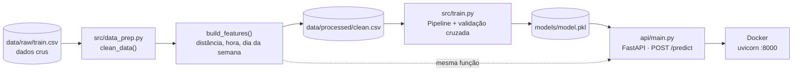
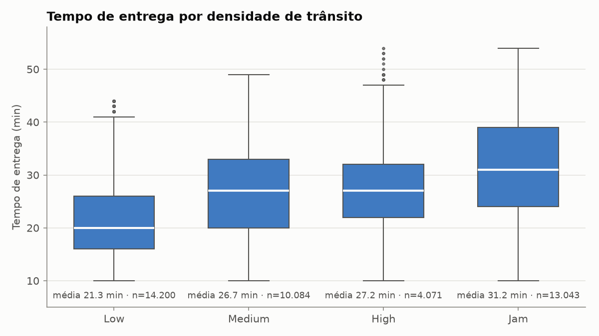
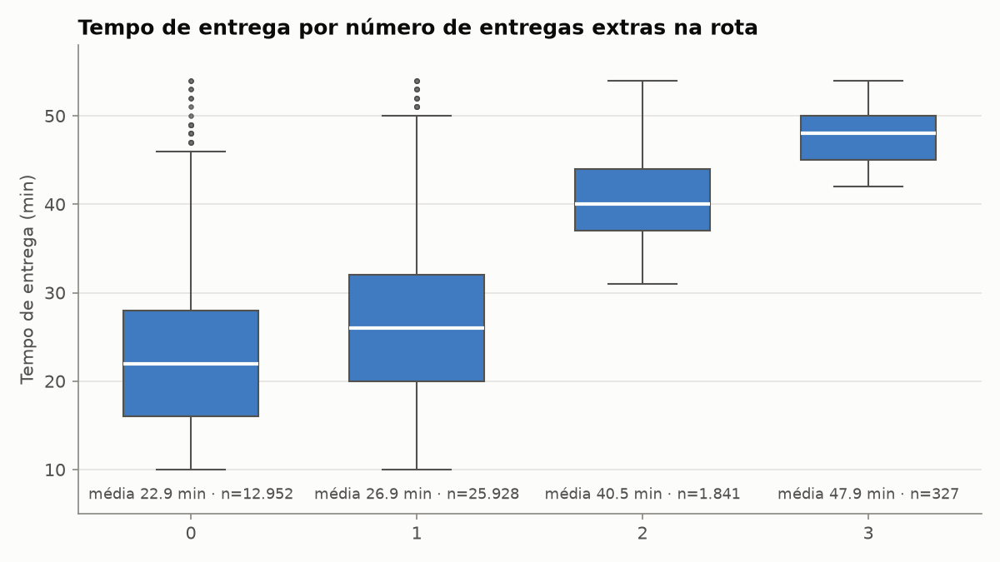
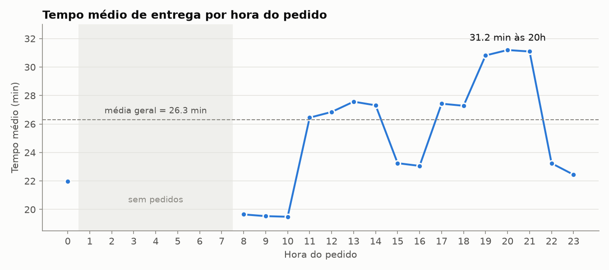

# Previsão de tempo de entrega

Modelo de machine learning que prevê, **no momento em que o pedido é feito**, quantos minutos a entrega vai levar — servido por uma API FastAPI em Docker.

> **MAE de 3,2 min contra 7,5 min do baseline (~58% menos erro), R² 0,82**
> (XGBoost, medido no conjunto de teste, que o modelo nunca viu)

## O problema

Quando um cliente faz um pedido, a plataforma precisa mostrar uma estimativa de entrega. Uma estimativa ruim gera frustração (atrasa) ou perde vendas (exagera). O objetivo é prever `Time_taken(min)` usando **só informações disponíveis no momento do pedido**: localização do restaurante e do cliente, perfil do entregador, clima, trânsito, veículo, tipo de pedido, data e hora.

Os dados são ~45 mil entregas de comida em cidades da Índia, do dataset [Food Delivery Dataset](https://www.kaggle.com/datasets/gauravmalik26/food-delivery-dataset) do Kaggle (arquivo `train.csv`).

## Arquitetura



A mesma `build_features()` é usada no treino e na API, então a API calcula as features exatamente como o modelo as viu no treino.

## Principais achados da EDA

A análise completa está em [`notebooks/01_eda.ipynb`](notebooks/01_eda.ipynb).

**Trânsito é o fator mais claro.** A mediana sobe de 20 min com trânsito *Low* para 31 min com *Jam* — cerca de 10 min de diferença, com grupos grandes.



**Entregas extras na mesma rota pesam muito.** Com 0 ou 1 entrega extra a média fica em 23–27 min; com 2 salta para 40 min e com 3 para 48 min. É a variável numérica com maior correlação com o tempo (r = 0,39).



**A hora do pedido tem efeito não linear.** Há picos no almoço (≈27 min) e principalmente no jantar, das 19h às 21h (≈31 min). Uma correlação linear (r = 0,19) subestima esse efeito — um bom motivo para usar modelos de árvore.



Outros achados:

- **Festival:** média de 45 min contra 26 min nos outros dias (mas só ~2% dos pedidos).
- **Clima:** *Sunny* é o mais rápido (22 min); *Cloudy* e *Fog*, os mais lentos (29 min).
- **Entregador:** avaliação mais alta → entrega mais rápida (r = −0,34); mais velho → mais lenta (r = 0,30).
- **Distância:** r = 0,32, com um degrau por volta de 10 km. Ela tem correlação de 0,58 com a hora (pedidos da noite são mais longe), então parte do efeito de uma aparece na outra.
- **Pouco efeito:** dia da semana e tipo de pedido.

## Comparação dos modelos

Todos usam o mesmo pré-processamento. Divisão 80/20 (`random_state=42`): 33.562 linhas de treino e 8.391 de teste.

| Modelo | MAE treino | MAE teste | RMSE teste | R² teste | MAE validação cruzada (5 folds) |
|---|---|---|---|---|---|
| Baseline (prevê a média) | 7,61 | 7,51 | 9,28 | 0,00 | 7,61 ± 0,05 |
| LinearRegression | 4,83 | 4,78 | 6,06 | 0,58 | 4,84 ± 0,05 |
| RandomForest | 1,18 | 3,20 | 4,05 | 0,81 | 3,21 ± 0,03 |
| **XGBoost** | 2,71 | **3,17** | **3,99** | **0,82** | **3,20 ± 0,03** |

O RandomForest decora o treino (MAE 1,18 no treino contra 3,20 no teste). O XGBoost generaliza melhor e foi o escolhido.

Variáveis mais importantes no XGBoost: trânsito (*Low* e *Jam*), clima (*Sunny*, *Fog*, *Cloudy*), entregas múltiplas, festival, avaliação do entregador e condição do veículo.

## Decisões técnicas

**Sem data leakage: a hora da coleta foi removida.** O dataset tem `Time_Order_picked`, a hora em que o entregador pegou o pedido no restaurante. Ela ajudaria o modelo, mas **não existe no momento do pedido** — só acontece depois. Usá-la daria uma métrica otimista que a API nunca conseguiria reproduzir. Pelo mesmo motivo, IDs do pedido e do entregador também saíram.

**Imputação dentro do pipeline.** A limpeza (`clean_data`) só marca os ausentes como `NaN`; ela não os preenche. O preenchimento (mediana nas numéricas, valor mais frequente nas categóricas) fica num `Pipeline` do scikit-learn junto com o modelo. Assim, a mediana é calculada só com o treino — em cada fold da validação cruzada e no treino final — e nunca "vê" o teste. O mesmo pipeline vai inteiro para o `model.pkl`, então a API imputa com os mesmos valores.

**Escolha do modelo pela validação cruzada, não pelo teste.** O melhor modelo é o de menor MAE médio em 5 folds dentro do treino. O conjunto de teste fica separado só para confirmar o resultado final; escolher por ele faria o número do teste deixar de ser uma estimativa honesta.

**`build_features()` compartilhada entre treino e API.** Distância (haversine), hora do pedido e dia da semana são calculados por uma única função em `src/data_prep.py`. A API converte o pedido recebido para o formato dos dados crus e chama a mesma função. Isso evita o erro clássico de o treino e a produção calcularem a mesma feature de jeitos diferentes. Conferido na prática: a primeira linha do dataset dá a mesma previsão (19,3 min) pela limpeza do treino e pela API.

**Outras limpezas relevantes:** valores ausentes escritos como texto (`"NaN "`) viram `NaN` de verdade; coordenadas com sinal trocado são corrigidas com `abs()`; coordenadas zeradas são descartadas (3.640 linhas); avaliações acima de 5 viram ausentes.

## Como rodar

Pré-requisitos: Python 3.13 e Docker.

O modelo treinado já está versionado em `models/model.pkl`, então os passos 4 a 6 (testes, Docker e previsão) funcionam direto do clone. Para refazer a limpeza e o treino (passos 2 e 3), baixe o `train.csv` do [Kaggle](https://www.kaggle.com/datasets/gauravmalik26/food-delivery-dataset) e coloque em `data/raw/train.csv` (a pasta `data/` não é versionada).

**1. Ambiente virtual**

```powershell
python -m venv venv
.\venv\Scripts\Activate.ps1        # Linux/macOS: source venv/bin/activate
pip install -r requirements.txt
```

**2. Limpeza dos dados** → gera `data/processed/clean.csv`

```bash
python src/data_prep.py
```

**3. Treino** → compara os modelos e salva `models/model.pkl`

```bash
python -m src.train
```

**4. Testes**

```bash
python -m pytest
```

**5. API no Docker** (o modelo vai dentro da imagem: depois de retreinar, rode o build de novo)

```bash
docker build -t delivery-time-api .
docker run -d --name delivery-time-api -p 8000:8000 delivery-time-api
```

Documentação interativa: <http://localhost:8000/docs>. Para rodar sem Docker: `uvicorn api.main:app --reload`.

**6. Previsão**

```bash
curl -X POST http://localhost:8000/predict \
  -H "Content-Type: application/json" \
  -d '{
    "restaurant_latitude": 22.745049,
    "restaurant_longitude": 75.892471,
    "delivery_latitude": 22.765049,
    "delivery_longitude": 75.912471,
    "delivery_person_age": 37,
    "delivery_person_rating": 4.9,
    "weather": "Sunny",
    "traffic": "High",
    "vehicle_condition": 2,
    "vehicle_type": "motorcycle",
    "order_type": "Snack",
    "multiple_deliveries": 0,
    "festival": false,
    "city": "Urban",
    "order_date": "2022-03-19",
    "order_time": "11:30:00"
  }'
```

```json
{"predicted_minutes": 19.3}
```

No PowerShell do Windows, `curl` é um apelido de outro comando; use `curl.exe` ou:

```powershell
$body = Get-Content order.json -Raw
Invoke-RestMethod -Method Post -Uri http://localhost:8000/predict -ContentType "application/json" -Body $body
```

**Validação da entrada.** Entradas fora dos limites retornam **422**: avaliação fora de 1–5, latitude/longitude inválidas, clima ou trânsito fora dos valores conhecidos, campos extras e distância restaurante → entrega acima de 25 km.

| Campo | Valores aceitos |
|---|---|
| `weather` | `Sunny`, `Cloudy`, `Windy`, `Fog`, `Stormy`, `Sandstorms` |
| `traffic` | `Low`, `Medium`, `High`, `Jam` |
| `vehicle_type` | `motorcycle`, `scooter`, `electric_scooter`, `bicycle` |
| `order_type` | `Snack`, `Meal`, `Drinks`, `Buffet` |
| `city` | `Urban`, `Metropolitian`, `Semi-Urban` (grafia igual à do dataset) |
| `delivery_person_rating` | 1 a 5 |
| `vehicle_condition`, `multiple_deliveries` | 0 a 3 |

## Estrutura

```
├── api/main.py              # API FastAPI
├── src/data_prep.py         # clean_data() e build_features()
├── src/train.py             # comparação de modelos e treino final
├── notebooks/01_eda.ipynb   # análise exploratória
├── tests/test_api.py        # testes da API
├── docs/images/             # gráficos do README
├── models/model.pkl         # pipeline final (XGBoost), versionado
├── data/                    # raw/ e processed/ (não versionado)
├── Dockerfile
├── requirements.txt         # ambiente de desenvolvimento
└── requirements-api.txt     # dependências da imagem, com versões fixas
```

## Limitações e próximos passos

**Limitações**

- **Dataset provavelmente sintético.** São entregas na Índia, mas o endereço de entrega é sempre o restaurante deslocado por um de apenas 12 valores (de 0,01° a 0,14°), igual em latitude e longitude. Por isso a distância só assume poucos valores discretos (o gráfico de dispersão mostra colunas, não uma nuvem). O desempenho em dados reais pode ser bem diferente.
- **Validade só até 25 km.** O treino tem entregas de até ~21 km; a API recusa pedidos acima de 25 km em vez de extrapolar.
- **O modelo depende de informações que o cliente não fornece**, como trânsito, clima e se haverá entregas múltiplas. Em produção, elas teriam de vir de outros serviços, no momento do pedido.
- **Grupos pequenos:** cidade *Semi-Urban* (149 pedidos) e bicicleta (60) têm poucos exemplos, e as previsões para eles são menos confiáveis.

**Próximos passos**

- **Ajuste de hiperparâmetros** do XGBoost (busca com validação cruzada), e testar codificar o trânsito como ordinal (Low < Medium < High < Jam).
- **Monitoramento de drift:** registrar as entradas e previsões da API e comparar a distribuição das features e o erro real com o treino, para saber quando retreinar.
- **Intervalo de previsão** em vez de um número só (por exemplo, "entre 25 e 32 min"), com regressão quantílica.
- **CI** rodando os testes e o build da imagem a cada commit.
